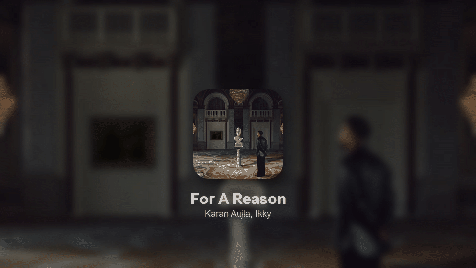

# 🎧 Sally — Real-Time Spotify Wallpaper Engine

Sally transforms your desktop into a dynamic music experience by automatically updating your wallpaper based on the song you're currently playing on Spotify.

It creates a clean, minimal UI with album art, blurred background, and glowing text — all updated in real-time with low latency.

---

## 🎬 Demo

### 🖥️ Wallpaper in Action

---

## ✨ Features

- 🎵 **Live Spotify Sync**
  - Detects currently playing track instantly

- 🖼️ **Dynamic Wallpaper Generation**
  - Uses album art to generate a blurred, aesthetic background

- ⚡ **Fast Updates**
  - When a song ends naturally, the wallpaper changes within ~1s (Sally times its next check to the end of the track)
  - Manual skips show up within ~5s — Spotify has no push API, so this is the polling interval that stays clear of rate limits

- 🎯 **Minimal UI Design**
  - Centered album card with soft shadow
  - Clean typography with subtle glow

- 🧠 **Smart Rendering Pipeline**
  - Image caching
  - Reduced resolution rendering + upscale
  - Efficient blur usage

- 🖥️ **Runs 24/7 in the System Tray**
  - No terminal window; starts with Windows
  - Tray menu: now playing, start with Windows, open log, quit

- 🔙 **Restores Your Wallpaper**
  - Your original wallpaper comes back when Sally exits

- 🎙️ **Podcasts and local files**
  - Podcast episodes use the episode art; local files without art are skipped safely

---

## ⚙️ Tech Stack

- Python  
- Spotipy (Spotify API)  
- Pillow (Image Processing)  
- PySide6 / Qt (system tray)  
- Windows API (Wallpaper Control)

---

## 🧠 How It Works

1. Fetch current track from Spotify API  
2. Download album artwork  
3. Generate wallpaper:
   - Blur background  
   - Add album card with shadow  
   - Render glowing text  
4. Apply wallpaper using Windows API  
5. Update overlay UI  

---

## ⚡ Performance Optimizations

- Renders at your real screen resolution; only the blurred background is built at quarter size and upscaled, so text stays sharp  
- Glow and shadow are blurred on small patches, not the whole screen  
- Bounded image cache (last 20 covers) to avoid re-downloads without leaking memory  
- One render thread that always draws the newest song; songs skipped mid-render are never lost  
- Rate-limit aware: honours Spotify's `Retry-After` cooldown  
- BMP output, alternating between two files so Windows never reads a half-written image  

---

## 🚀 Setup

### 1. Clone the repo

git clone https://github.com/muaz-q/Sally.git  
cd Sally  

---

### 2. Install dependencies

python -m venv .venv  
.venv\Scripts\pip install -r requirements.txt  

---

### 3. Setup Spotify API

1. Create an app at the [Spotify Developer Dashboard](https://developer.spotify.com/dashboard)
2. Add `http://127.0.0.1:8888/callback` as a Redirect URI (Spotify no longer accepts `localhost`)
3. Copy `.env.example` to `.env` and fill it in:

SPOTIFY_CLIENT_ID=your_client_id  
SPOTIFY_CLIENT_SECRET=your_client_secret  
SPOTIFY_REDIRECT_URI=http://127.0.0.1:8888/callback  

The first run opens a browser to log in to Spotify; the token is cached in `.cache` after that.

---

### 4. Run the project

For the first run, use a terminal so you can see any errors:

.venv\Scripts\python main.py  

After that Sally lives in the system tray (the glowing dot by the clock) and starts by itself when you log in. To start it by hand with no console:

.venv\Scripts\pythonw main.py  

Right-click the tray icon → **Quit Sally** to stop it; your old wallpaper is put back. Logs go to `sally.log`.

---

## ⚠️ Limitations

- Windows only (uses Windows wallpaper API)  
- Requires active Spotify playback  
- Wallpaper animations are limited by OS constraints  

---

## 🔮 Future Improvements

- Smooth transitions between tracks  
- Multi-monitor support (currently renders for the primary screen)  
- Custom themes (dark/light/neon)  
- Lyrics / karaoke mode  

---

## 💡 Inspiration

Inspired by modern music UIs like:
- Spotify Canvas  
- Apple Music  
- iOS Lock Screen widgets  

---

## 👤 Author

Muaz  
Second-year AIML student building real-world systems 🚀  

---

## ⭐ If you like this project

Give it a star — it helps a lot!
