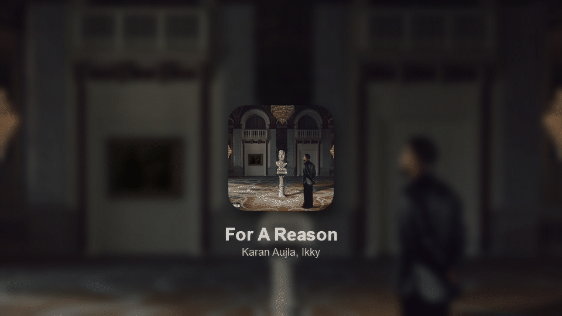

# 🎧 Sally — Real-Time Spotify Wallpaper Engine

Sally transforms your desktop into a dynamic music experience by automatically updating your wallpaper based on the song you're currently playing on Spotify.

Around the cover, neon rings orbit in the song's colours, with playback controls, synced lyrics and your top tracks on the desktop. Install it with one command, sign in once, and it runs by itself.

---

## 🎬 Demo

### 🖥️ Wallpaper in Action

The wallpaper rebuilds itself from the album art every time the song changes:




---

## 🚀 Install

You need Windows 10/11 and [Python 3.10 or newer](https://www.python.org/downloads/). Then, in any terminal:

```
pip install pipx
pipx ensurepath
pipx install git+https://github.com/muaz-q/Sally.git
```

Open a **new** terminal and type:

```
sally
```

The first time, your browser opens Spotify's sign-in page: click **Agree** and you're done. There are no keys or `.env` files to fill in. Sally then lives in the system tray, next to the clock, and starts with Windows.

> **Spotify's sign-in limit:** Sally's built-in Spotify app is in Spotify's *development mode*, so only accounts its owner has added in the Spotify Developer Dashboard can sign in. If Spotify says the app isn't available to you, either ask to be added, or make your own free app at the [Spotify Developer Dashboard](https://developer.spotify.com/dashboard): add `http://127.0.0.1:8888/callback` as its Redirect URI and run `sally login --client-id YOUR_CLIENT_ID`. You don't need a client secret.

---

## ⌨️ Commands

| Command | What it does |
|---|---|
| `sally` | Start Sally (signs in to Spotify the first time) |
| `sally stop` | Quit and put your own wallpaper back |
| `sally status` | What's playing, whether live mode is on, battery |
| `sally live on` / `off` | The animated rings, controls, lyrics and spiral. Off = the plain cover wallpaper, with almost no battery use |
| `sally battery on` / `off` | Let live mode rest by itself on battery saver or low battery (`--below 30` to change the default 20%) |
| `sally autostart on` / `off` | Start with Windows |
| `sally login` / `logout` | Sign in or out of Spotify (`--client-id` to use your own Spotify app) |
| `sally history` | Open the listening-history dashboard |
| `sally logs` | Open the log file |
| `sally uninstall` | Stop Sally and remove its settings and startup entry, then run `pipx uninstall sally-wallpaper` |

Live mode and the battery switch are also in the tray menu and behind the ⚙ button. While live mode is off, the small Sally header stays in the top-right corner with a **Live on** button to bring it back. Settings, the log and the Spotify sign-in are kept in `%LOCALAPPDATA%\Sally`.

---

## ✨ Features

- 🎵 **Live Spotify sync**: the wallpaper rebuilds from the album art every time the song changes
  - When a song ends naturally, the wallpaper changes within ~1s (Sally times its next check to the end of the track)
  - Manual skips show up within ~5s. Spotify has no push API, so this is the polling interval that stays clear of rate limits

- 🌌 **Live mode** (on by default)
  - Neon rings orbit the cover in the song's own colours, drawn by the graphics card so they keep moving all the time
  - On a song change the rings recolour, sparks spiral in, and the new cover swirls into place
  - The old wallpaper dissolves into the new one instead of jumping
  - Play/pause, skip, shuffle, repeat and a seek bar (playback control needs Spotify Premium)
  - Synced lyrics from [LRCLIB](https://lrclib.net)
  - Your top tracks orbit the cover like the glowing dots, each on its own faintly glowing orbit: they grow out from behind the cover, orbit, then their orbits shrink and they sink back in, and the next seven come out (hover one to stop them, click to play)

- 🕘 **Listening history**: a frosted-glass dashboard (tray menu, ⚙ menu or `sally history`) with a light that keeps running round its edge, every song you've played grouped by day, today / week / all-time counts, a 7-day chart and your top artist and song. Filter by today or the last 7 days, click a recent song to play it again, and click anywhere outside (or ×, or Esc) to close it

- 🔋 **Battery aware**
  - Live mode rests by itself when battery saver is on, or below 20% while unplugged, and comes back when you plug in
  - Resting leaves the plain wallpaper with the cover and title, and Sally uses almost no CPU
  - Stops drawing while an app covers the whole desktop or the PC is locked, and picks up again the moment the desktop shows

- 🖥️ **Runs 24/7 in the system tray**: no terminal window, and it starts with Windows

- 🔙 **Restores your wallpaper**: your original wallpaper comes back when Sally exits

- 🎙️ **Podcasts and local files**: podcast episodes use the episode art; local files without art are skipped safely

---

## ⚙️ Tech Stack

- Python
- Spotipy (Spotify API, PKCE sign-in)
- Pillow (wallpaper rendering)
- PySide6 / Qt Quick (tray, animated desktop widgets)
- Windows API (wallpaper control, battery status)

---

## ⚡ Performance

- Live mode uses about a tenth of one CPU core on a typical laptop while the desktop is in view; with it off, or while a maximised app covers the desktop, about 3–4%
- The rings, sparks and spiral are pre-drawn once per song and only moved by the graphics card each frame
- The wallpaper renders at your real screen resolution; only the blurred background is built at quarter size and upscaled, so text stays sharp
- Bounded image cache (last 20 covers) to avoid re-downloads without leaking memory
- One render thread that always draws the newest song; songs skipped mid-render are never lost
- Rate-limit aware: honours Spotify's `Retry-After` cooldown

---

## 🛠️ Developing

```
git clone https://github.com/muaz-q/Sally.git
cd Sally
python -m venv .venv
.venv\Scripts\pip install -e .
.venv\Scripts\sally run
```

`sally run` keeps Sally in the foreground, so errors show in the terminal.

---

## ⚠️ Limitations

- Windows only for now; Linux and macOS are planned
- Requires active Spotify playback
- Multi-monitor setups use the primary screen

---

## 🔮 Future Improvements

- Multi-monitor support (currently renders for the primary screen)  
- Linux and macOS  
- Custom themes (dark/light/neon)  

---

## 💡 Inspiration

Inspired by modern music UIs like:
- Spotify Canvas  
- Apple Music  
- iOS Lock Screen widgets  

---

## 👤 Author

Muaz  
Second-year AIML student building real-world systems 🚀  

---

## ⭐ If you like this project

Give it a star — it helps a lot!
